# AUTOSAR HLD Document Analysis Assistant

**Technical Report** · Capstone Project, Case Study 1 (Automotive Engineering AI)

| | |
|---|---|
| Student | Kiran Soorya R S |
| Register number | 126003133 |
| Programme | B.Tech Computer Science and Engineering |
| University | SASTRA Deemed University |
| Version | 1.0 |

<div class="toc" markdown="1">

**Contents**

1. Problem statement and intended users
2. Input data and knowledge base
3. Solution architecture
4. Implementation and configuration
5. Evaluation steps and results
6. Responsible AI measures
7. Innovation highlights
8. Limitations and future work
9. Conclusion

References · Appendix A: Prompts · Appendix B: Test suite

</div>

## 1. Problem statement and intended users

### 1.1 Problem

AUTOSAR High-Level Design (HLD) documents describe the software architecture of an electronic
control unit (ECU): its software components (SW-Cs), the port interfaces between them, ports,
signals, dependencies and functional flows. In practice they are long PDF documents made mostly of
tables. Three problems follow:

- **Slow lookup.** A simple question such as *"which components consume WheelSpeedIf?"* requires
  reading across the interface, port, signal and dependency tables by hand.
- **Hidden inconsistencies.** An interface that some component requires but no component provides,
  or a dependency on a component that is never defined, is easy to miss when the tables are spread
  over many pages, and harder still across document revisions.
- **Unsafe shortcuts.** General-purpose chatbots answer from training data, give no sources and can
  invent plausible component names, which is unacceptable for design reviews and safety work.

### 1.2 Objectives

Following Case Study 1, the system should:

1. reduce the manual effort of reviewing HLD documents;
2. build a structured, searchable inventory of the architecture;
3. answer natural-language questions **only from the documents**, citing document, page and
   section, and refuse when the documents do not contain the answer;
4. detect inconsistencies and compare document revisions;
5. keep an engineer in control: no extracted element is final until a person reviews it, and every
   decision is logged.

### 1.3 Intended users

| User | Uses the assistant to |
|---|---|
| System and AUTOSAR architects | Review a design, find inconsistencies, compare revisions, approve extracted elements |
| Software developers | Look up ports, interfaces and signals quickly, with page references |
| Integration and test engineers | Export the interface and signal inventory for integration and test planning |
| Engineering managers | Follow review progress and the audit log |

## 2. Input data and knowledge base

| Document | Pages | Content | Role |
|---|---|---|---|
| `vbcs_brake_system_hld.pdf` | 24 | Vehicle Brake Control System HLD (VBCHLD-001 rev 1.0), a synthetic test document obtained from an external website [2]: 6 SW-Cs on 3 ECUs, 10 port interfaces (7 sender-receiver, 3 client-server), 29 ports (10 provided, 19 required), 11 signals, 6 CAN messages, 19 dependencies, 8 functional flows, diagnostics and degraded mode | Main knowledge base and evaluation document; ID-numbered tables |
| `ebc_brake_ecu_hld.pdf` | 2 | Electronic Brake Control ECU HLD, rev 1.2 (synthetic): 4 SW-Cs, 4 interfaces, 6 ports, 6 signals, 3 dependencies, 1 flow | Plain tables without ID columns |
| `ebc_brake_ecu_hld_v1_3.pdf` | 2 | Rev 1.3 of the same document, with deliberate changes and defects | Revision comparison and consistency-check evaluation |
| AUTOSAR EXP Virtual Functional Bus; CP SWS Platform Types; TR Foundation Release Overview | 161 | Public AUTOSAR specifications (© AUTOSAR GbR) [3] | General AUTOSAR background knowledge |

All HLD documents are synthetic, so no proprietary or personal data is processed.

**Preparation.** Each PDF is read page by page with pypdf. Section headings (`1. Introduction`,
`3.2 BrakeControlSWC`, `Section 4. …`) are detected with a pattern that rejects numbered sentences.
Pages listing twelve or more headings are recognised as tables of contents and not indexed, because
they repeat every heading without containing facts. The text is split into 800-character passages
with a 150-character overlap, separately for each page so that every passage has an exact page
citation, and each passage is labelled with the section heading in force at its midpoint. The
24-page HLD yields 105 passages.

## 3. Solution architecture

### 3.1 Overview

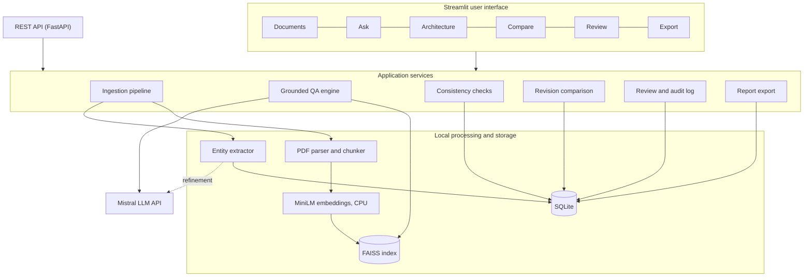

*Figure 1. System architecture.* The Streamlit pages and the REST API are thin layers over the same
service functions, so both behave identically and both are covered by the same tests.

### 3.2 Pre-trained models

| Model | Role | Where it runs | Fine-tuned |
|---|---|---|---|
| `all-MiniLM-L6-v2` (sentence-transformers) | Embeds passages and questions into 384-dimensional unit vectors | Locally on the CPU | No |
| `ministral-8b-latest` (Mistral AI) | Writes grounded answers; refines entity extraction | Mistral API | No |

No model is fine-tuned. Retrieval-Augmented Generation (RAG) was chosen instead because each
project's HLD is different and changes over time: RAG uses the current document without retraining,
can cite the exact page, and needs neither training data nor a GPU.

### 3.3 RAG pipeline design

The question-answering pipeline has two independent safeguards. The **evidence gate** runs before
the language model: if no passage is close enough to the question, the question is refused and the
model is never called. The **refusal check** runs after it: the prompt obliges the model to answer
with one fixed sentence when the passages do not contain the answer, and the code recognises that
sentence.

Distances are squared L2 distances between unit vectors, which equal 2 − 2·cos θ: 0 means identical
meaning, 2 means unrelated. The gate threshold is 1.1 (cosine similarity ≥ 0.45), chosen from the
evaluation in Section 5.

### 3.4 Extraction design

Extraction is deterministic first and model-assisted second:

1. **Naming-convention patterns** find candidates (`…SWC`, `…_If`, `PP_…`/`RP_…`, signal suffixes).
2. **Table-row parsers** read ID-numbered rows (`SWC-01`, `IF-01`, `P-01`, `D-01`, `FF-xx` headings)
   and plain rows (`Name_SWC  Application  …`). When a document has a table for an element type, the
   table is authoritative and replaces the pattern guesses.
3. **LLM refinement** (when a model is configured) sends up to 12,000 characters from the pages that
   mention the most architecture names, and asks for JSON. Its output is cleaned, may fill missing
   attributes, and may add elements **only for element types that the document does not define in a
   table**. Anything it adds is labelled `source = llm` for review.
4. **Filters** remove 38 AUTOSAR Basic Software module names (CanIf, PduR, Com, NvM, …) and names
   that are ports or operations rather than signals.

## 4. Implementation and configuration

### 4.1 Technology

| Layer | Choice |
|---|---|
| User interface | Streamlit 1.65 (top navigation, light and dark theme) |
| Service layer | FastAPI (REST endpoints for documents, entities, questions, checks, comparison, reviews) |
| PDF parsing | pypdf |
| Embeddings and vector search | sentence-transformers (all-MiniLM-L6-v2), FAISS `IndexFlatL2` |
| Language model | Mistral `ministral-8b-latest` via the OpenAI-compatible API (Azure OpenAI also supported) |
| Structured storage | SQLite: documents, six element tables, review log |
| Testing | pytest, 84 tests with offline test doubles |

### 4.2 Ingestion workflow

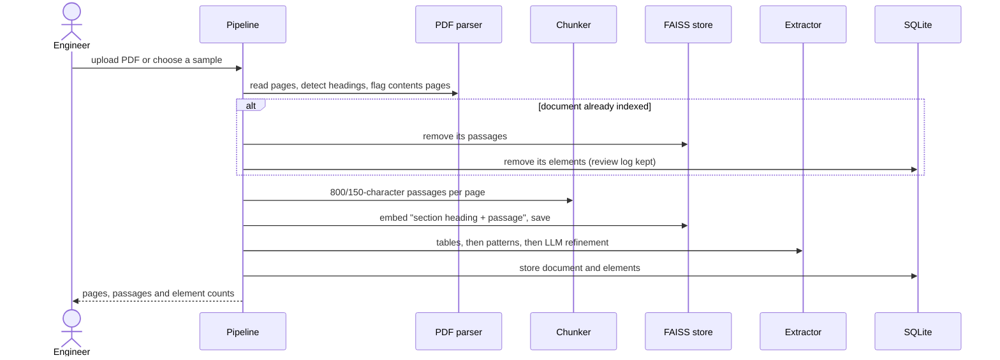

*Figure 2. Ingestion workflow.* Re-indexing a document replaces its earlier version instead of
duplicating it.

### 4.3 Question-answering workflow

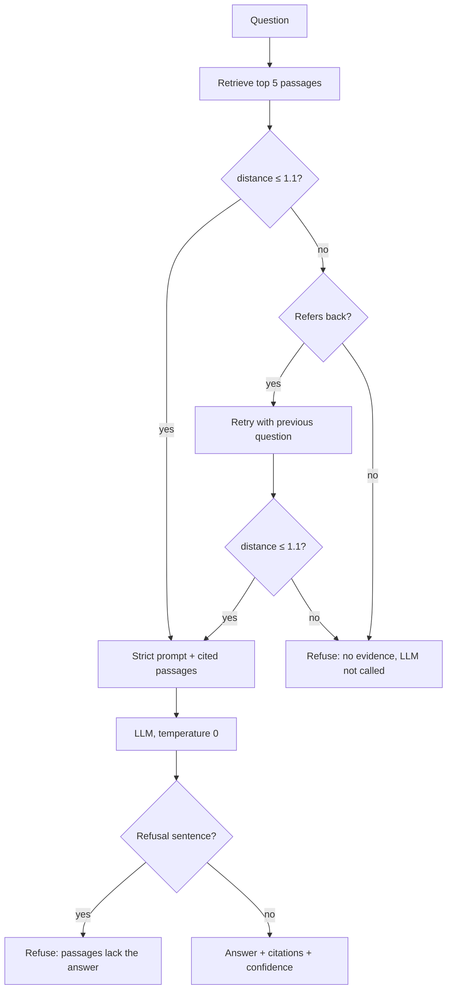

*Figure 3. Grounded question answering with two safeguards.*

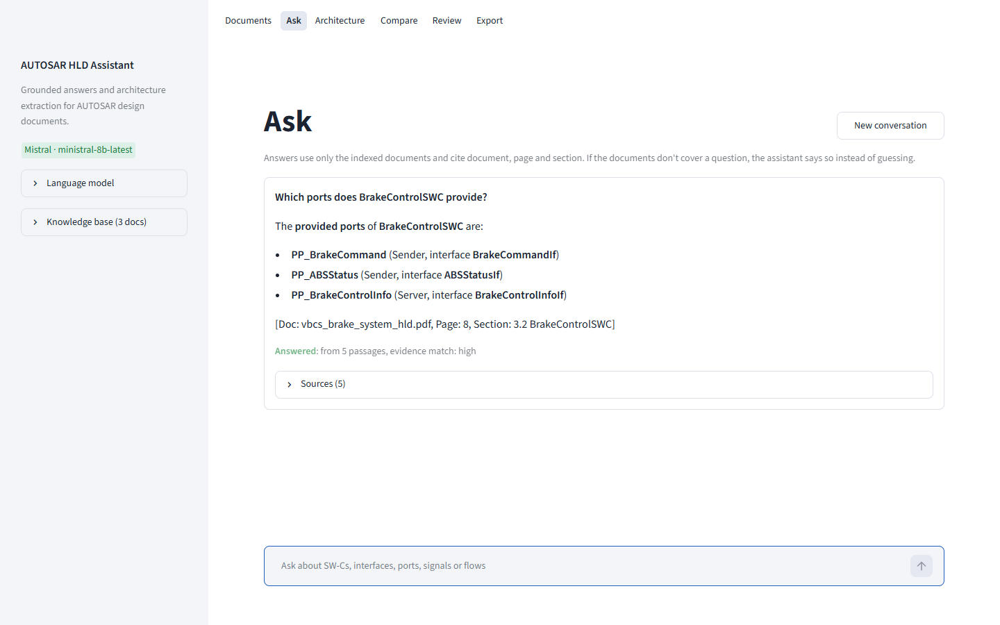

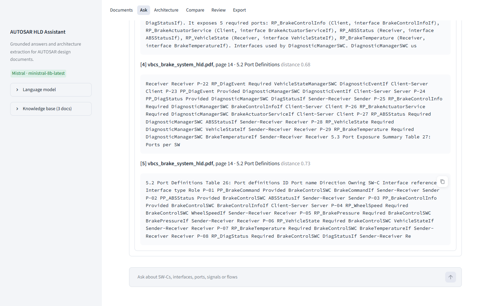

### 4.4 Review workflow

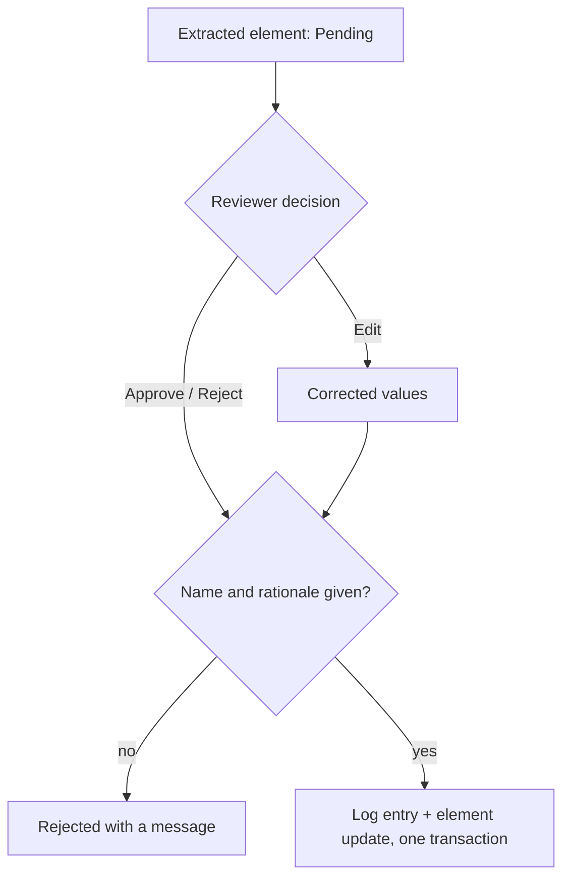

*Figure 6. Human-in-the-loop review.*

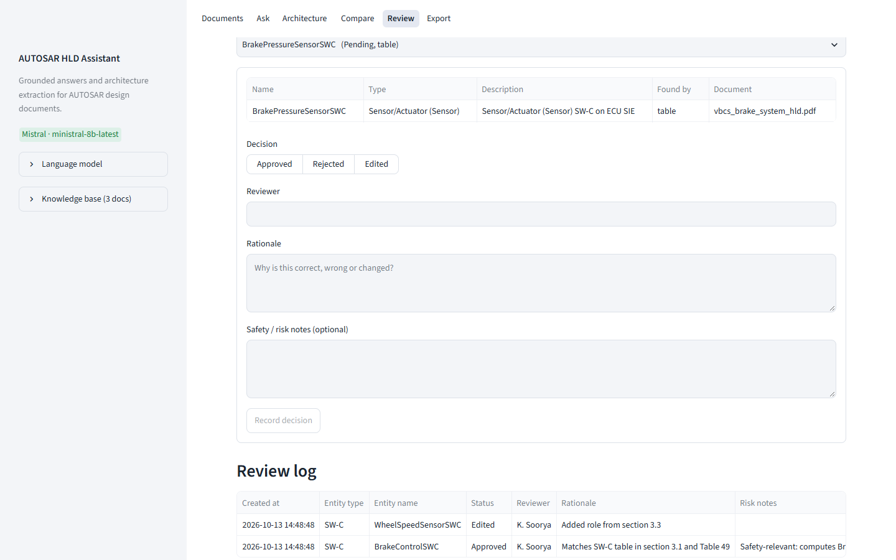

### 4.5 Consistency checks and revision comparison

Both run on the extracted tables without the language model. For each interface the checker builds
the set of SW-Cs that provide it and the set that require it, and reports:

| Check | Severity |
|---|---|
| Interface required but provided by no SW-C (missing provider) | Error |
| Port owner or dependency end not defined as a SW-C | Error |
| Port refers to an interface missing from the interface table | Error |
| Interface provided but never required | Warning |
| Defined SW-C with no ports | Warning |
| Dependency without a matching provided/required port pair | Warning |
| Signal on an interface no port uses; signal without a data type | Warning / Info |

Client-server dependencies are accepted in either direction because documents write them client →
server. The revision comparison matches elements by identity (name; owner and port name for ports;
source, target and interface for dependencies) and reports additions, removals and attribute changes.

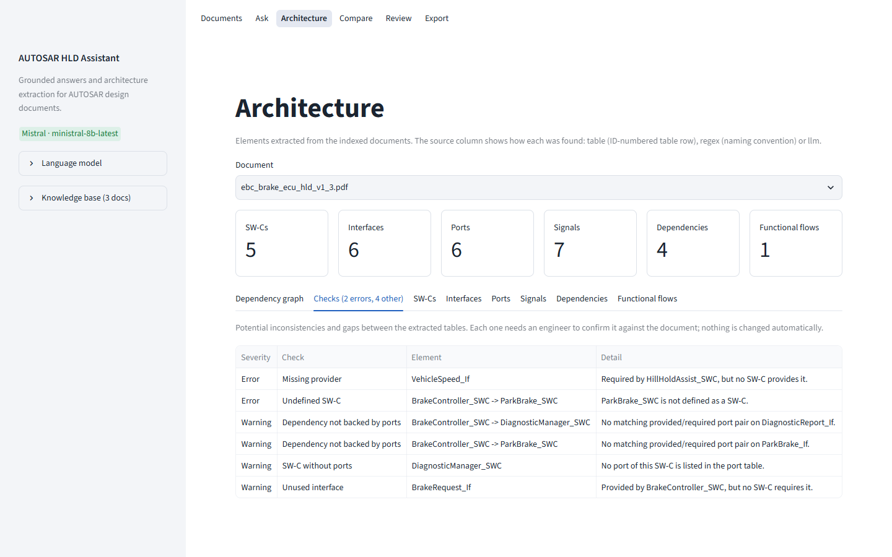

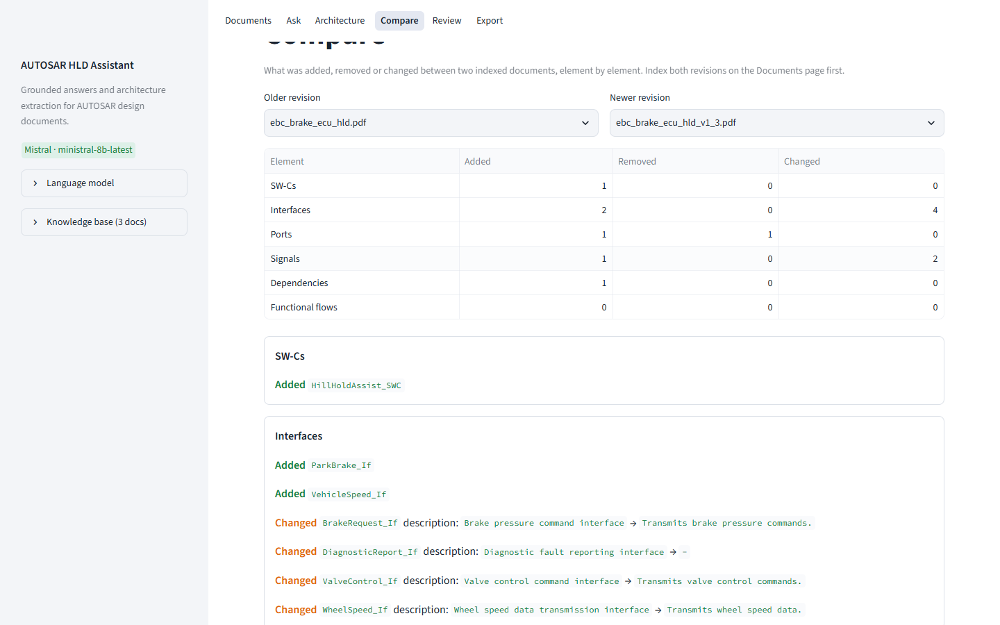

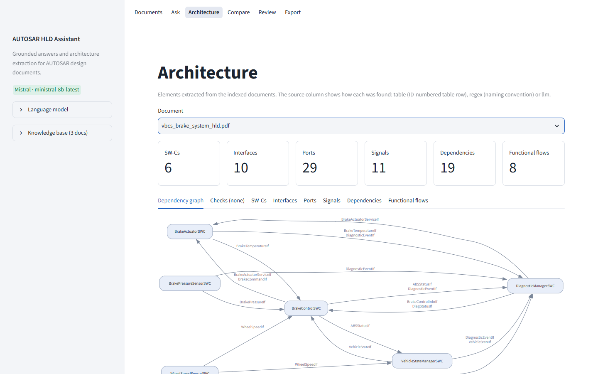

### 4.6 Configuration

| Setting | Value |
|---|---|
| Chunk size / overlap | 800 / 150 characters, per page |
| Passages retrieved | 5 |
| Evidence gate | squared L2 distance ≤ 1.1 |
| Evidence-match label | High ≤ 0.75, Medium ≤ 0.95, Low above |
| Generation | temperature 0; 1,500 tokens for answers; last 6 conversation turns |
| LLM extraction | 12,000 characters of the most architecture-dense pages; JSON mode; 6,000 tokens |
| Storage | `data/` folder: SQLite database, FAISS index, uploaded files |

All settings come from environment variables or a `.env` file. The API key is never stored in code.
Model settings entered in the sidebar apply to that browser session only. The full prompts are in
Appendix A and in `Model_Prompts_Config/`.

## 5. Evaluation steps and results

### 5.1 Method

| Step | What was measured | Ground truth |
|---|---|---|
| 1 | Unit tests (84) | Assertions, with fake language model and fake retriever objects so no network is needed |
| 2 | Entity extraction: precision and recall per element type | VBCS: the document's own architecture summary (Table 49, page 24). EBC: the generator's data |
| 3 | Retrieval and evidence gate on 17 questions | 11 answerable questions with expected terms; 6 unanswerable (4 off-topic, 2 on-topic "hard negatives") |
| 4 | Threshold sweep from 1.00 to 1.60 | Same question set |
| 5 | Consistency checks and revision comparison | The consistent VBCS document; EBC rev 1.3 with planted defects |
| 6 | End-to-end answers with `ministral-8b-latest` | Correct = answered and all expected terms present; for unanswerable questions, correct = refused |

Everything is reproducible with `python evaluation\run_evaluation.py --llm`, which builds a fresh
knowledge base in a temporary folder and writes the results to `Evaluation_Results/`.

### 5.2 Extraction

| Document | SW-Cs | Interfaces | Ports | Signals | Dependencies | Flows |
|---|---|---|---|---|---|---|
| VBCS, expected | 6 | 10 | 29 | 11 | 19 | 8 |
| VBCS, extracted | 6 | 10 | 29 | 11 | 19 | 8 |
| EBC rev 1.2, expected | 4 | 4 | 6 | 6 | 3 | 1 |
| EBC rev 1.2, extracted | 4 | 4 | 6 | 6 | 3 | 1 |

Precision and recall are **1.00 for every element type** on both documents; the VBCS split of 10
provided and 19 required ports also matches. Attributes are read from the tables (for example
`BrakePressureCmd`: `uint16`, `kPa`) rather than guessed. With LLM refinement switched on, the HLD
results are unchanged, as designed; on the AUTOSAR VFB specification, which has no architecture
tables, refinement raised the extracted SW-Cs from 2 to 9 and interfaces from 0 to 14 (the
specification's seat-heating example), all labelled for review.

### 5.3 Retrieval and evidence gate

| Measure | Result |
|---|---|
| Answerable questions passing the gate | 11 / 11 (largest distance 1.046) |
| Unanswerable questions blocked before the model | 5 / 6 |
| Distances of off-topic questions | 1.58 – 1.99 |
| Tyre-pressure hard negative | 1.156 (blocked) |
| ASIL hard negative | 0.514 (passes; on topic but not answered by the documents) |

| Threshold | 1.00 | 1.05 | 1.10 | 1.20 | 1.40 | 1.60 |
|---|---|---|---|---|---|---|
| Answerable passing | 10 | 11 | **11** | 11 | 11 | 11 |
| Unanswerable blocked | 5 | 5 | **5** | 4 | 4 | 3 |

The value 1.1 lets every answerable question through and blocks the most unanswerable ones. The
margin between the hardest answerable question (1.046) and the tyre-pressure question (1.156) is
small, which is noted as a limitation.

### 5.4 End-to-end answers

| Measure | Result |
|---|---|
| Answerable questions answered correctly | **10 / 11** |
| Answers containing an inline citation | **10 / 10** |
| Unanswerable questions refused | **6 / 6** (5 by the gate, 1 by the model) |
| Time per answer | 1.0 – 2.5 seconds |

The ASIL question passed the gate but the model replied with the refusal sentence, so the second
safeguard worked as intended. The one miss, Q11 (data type of `BrakePressureCmd` in the EBC
document), was a *false refusal*: the closest passage was the document's first page, while the
signal table is on page 2, and the model declined rather than guess. This is the safe failure mode.

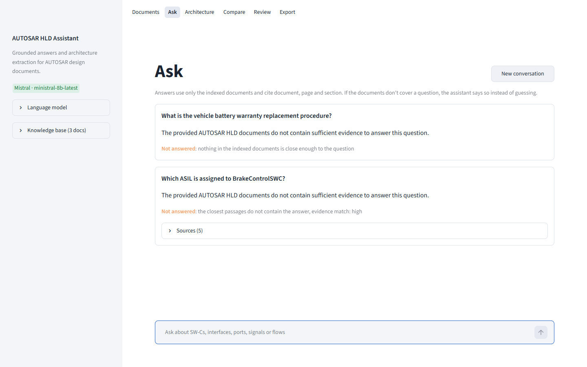

### 5.5 Consistency checks and comparison

On the consistent VBCS document the checker reports **no findings**. On EBC rev 1.3 it finds every
planted defect: the missing provider of `VehicleSpeed_If`, the dependency on the undefined
`ParkBrake_SWC`, the unused `BrakeRequest_If`, and the component without ports. It also reports a
real gap present in both revisions: `DiagnosticManager_SWC` has no ports in the port table. The
comparison of rev 1.2 and rev 1.3 reports 1 added SW-C, 2 added interfaces, 1 added and 1 removed
port, 1 added signal with 2 changed attributes (`uint16 → float32`, `kPa → bar`) and 1 added dependency.

## 6. Responsible AI measures

### 6.1 Grounding

- Answers use only retrieved passages from the indexed documents.
- The evidence gate stops unsupported questions **before** the model is called.
- The prompt forbids outside knowledge, requires a citation for every statement and defines a fixed
  refusal sentence, which the code detects.
- Temperature 0 gives repeatable, factual answers.
- Every answer shows its sources, their distances and an evidence-match label (High, Medium, Low).
- Extraction is deterministic first; the model cannot override or extend table-defined data, and its
  additions are labelled.

### 6.2 Privacy

| Data | Leaves the machine? |
|---|---|
| PDFs, embeddings, vector index, extracted elements, review log | No |
| A question, its top 5 passages and the last 6 conversation turns | Yes, to the configured model provider |
| Up to 12,000 characters of a document | Only when indexing with LLM refinement on |
| Usage statistics | No (disabled) |

For confidential documents the system can use Azure OpenAI in the organisation's own tenant, or run
without a model: extraction, search, citations, checks, comparison and review all work offline.

### 6.3 Security

- API keys come from the environment or a git-ignored `.env` file and are never written by the
  application; keys typed in the sidebar apply to one browser session only.
- All SQL uses parameter placeholders; table names come from a fixed internal map.
- Uploads are restricted to PDF, limited to 50 MB, and stored under sanitised names to prevent
  path traversal.
- The index is written atomically and checked for consistency when loaded.
- The model has no tools and cannot take actions, which limits the effect of prompt injection;
  citations let the reader check any answer.
- Limitation: there is no login or role-based access; the system is a local, single-user pilot.

### 6.4 Human oversight

Every extracted element starts as *Pending*. A reviewer records *Approved*, *Rejected* or *Edited*,
with a mandatory name and rationale and optional safety notes. Edits apply the corrected values and
log both old and new values. The review log is append-only, timestamped, included in every export,
and kept when documents are removed or the knowledge base is reset. Consistency findings are
suggestions for an engineer to confirm; the system never approves anything by itself, in line with
the case study's governance principle.

## 7. Innovation highlights

1. **Two-stage grounding.** An evidence gate before generation and refusal detection after it. Both
   refusal paths were exercised in the evaluation (5 gate refusals, 1 model refusal).
2. **Layout-tolerant table parsing.** Rows are recognised by their shape (an ID cell followed by
   typed cells), so the parsers work regardless of how the PDF text is laid out, and reproduce the
   document's own summary counts exactly.
3. **Section-aware retrieval.** Each passage is embedded together with its section heading, and
   table-of-contents pages are excluded; table-heavy passages become findable by topic.
4. **Constrained LLM refinement.** The model sees only the most architecture-dense pages, must return
   JSON, is cleaned and de-duplicated, and may not add to element types the document defines in tables.
5. **AUTOSAR-aware consistency checking.** Provider/consumer matching per interface, client-server
   direction handling, and a Basic Software filter.
6. **Revision comparison keyed on AUTOSAR identity**, for example owner and port name, because the
   same port name exists on several components.
7. **Audited human review** with old and new values for every correction, kept across resets.
8. **One service layer behind both a UI and a REST API**, with 84 automated tests that run offline.

## 8. Limitations and future work

| Limitation | Future work |
|---|---|
| Scanned PDFs are not supported (no OCR) | Add Tesseract OCR for pages without a text layer |
| Small evaluation set (17 questions, synthetic documents); the threshold was tuned on the same set | Re-calibrate on real project documents with a larger question set |
| Narrow margin between the hardest answerable question (1.046) and the nearest unanswerable one (1.156) | Re-ranking, or an entailment check between answer and passages |
| On-topic but unanswerable questions pass the gate and rely on the model's refusal | Entailment check before showing an answer |
| A small model can decline a question its passages answer (Q11) | Larger model, or more passages per question |
| Table parsers expect ID-numbered or plain rows | More layouts, or a table-aware PDF parser |
| No authentication, single user, local deployment | Access control, PostgreSQL and Docker, as in the case study's scale phase |

## 9. Conclusion

The assistant turns long, table-heavy AUTOSAR HLD documents into a searchable, checkable and
reviewable architecture model. On the evaluation documents it extracted every architecture element
correctly, answered 10 of 11 answerable questions correctly with citations, refused all 6 questions
the documents could not answer, and found every planted design defect, while keeping documents local
and leaving every decision to an engineer. The main next steps are OCR, an answer-entailment check
and evaluation on real project documents.

## References

1. Automotive Engineering AI: Standard Project Case Study Document, Case Study 1 "AUTOSAR HLD Document Analysis Assistant", version 1.0, course material.
2. *Vehicle Brake Control System High-Level Design*, document VBCHLD-001 rev 1.0 (synthetic test document), obtained from an external website.
3. AUTOSAR, *Explanation of the Virtual Functional Bus* (EXP_VFB); *Specification of Platform Types* (CP SWS PlatformTypes); *Foundation Release Overview* (TR). AUTOSAR GbR, www.autosar.org.
4. P. Lewis et al., "Retrieval-Augmented Generation for Knowledge-Intensive NLP Tasks", NeurIPS 2020.
5. N. Reimers and I. Gurevych, "Sentence-BERT: Sentence Embeddings using Siamese BERT-Networks", EMNLP 2019 (sentence-transformers; model all-MiniLM-L6-v2).
6. J. Johnson, M. Douze and H. Jégou, "Billion-scale similarity search with GPUs", IEEE Transactions on Big Data, 2019 (FAISS).
7. Mistral AI, API documentation, docs.mistral.ai.
8. Streamlit, FastAPI, pypdf and SQLite documentation.

## Appendix A: Prompts

**Grounded question answering (system prompt).**

```text
You answer questions about AUTOSAR High-Level Design (HLD) documents for automotive software engineers.

Rules:
1. Use only the information in the numbered passages under CONTEXT. Do not add facts from general knowledge.
2. Cite the passage behind each statement as [Doc: <name>, Page: <number>, Section: <section>].
3. Use earlier turns of the conversation only to work out what the question refers to.
4. Be concise. Prefer lists and tables when listing components, ports or signals.
5. If the passages do not contain the answer, reply with exactly this sentence and nothing else:
The provided AUTOSAR HLD documents do not contain sufficient evidence to answer this question.
```

The user message contains `QUESTION: <question>` followed by `CONTEXT:` and the five numbered
passages, each labelled with document, page and section.

**Extraction refinement (system prompt).**

```text
You extract software architecture elements from AUTOSAR High-Level Design documents.

Return a JSON object with exactly these keys, each holding a list of objects:
- "swcs": {"name", "type", "description"}
- "interfaces": {"name", "type" ("Sender-Receiver" or "Client-Server"), "description"}
- "ports": {"name", "direction" ("Provided" or "Required"), "swc_owner", "interface_ref"}
- "signals": {"name", "data_type", "unit", "interface_ref"}
- "dependencies": {"source_swc", "target_swc", "interface_name"}
- "functional_flows": {"flow_name", "sequence", "description"}

Copy names exactly as written in the text. Include only elements that appear in the text.
List each element once. Keep every description under 12 words.
A functional flow "sequence" is a chain of component names such as "A -> B -> C".
Do not list AUTOSAR Basic Software modules such as CanIf, PduR, Com, NvM, Dem or Rte.
```

## Appendix B: Test suite

84 automated tests cover: heading detection and contents pages; chunking; extraction on both HLDs
(including exact summary counts and the table safeguard for LLM refinement); cleaning and salvaging
of model output; vector-store persistence and per-document removal; all grounding paths (no evidence,
answered, model refusal, no model, model error, follow-up handling, confidence labels); database
migration and editable-field guards; review validation; consistency checks and revision comparison;
re-indexing without duplication; exports; and every REST endpoint. The full log is in
`Evaluation_Results/126003133_UnitTestResults_v1.0.txt`.
