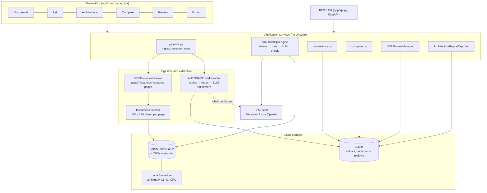
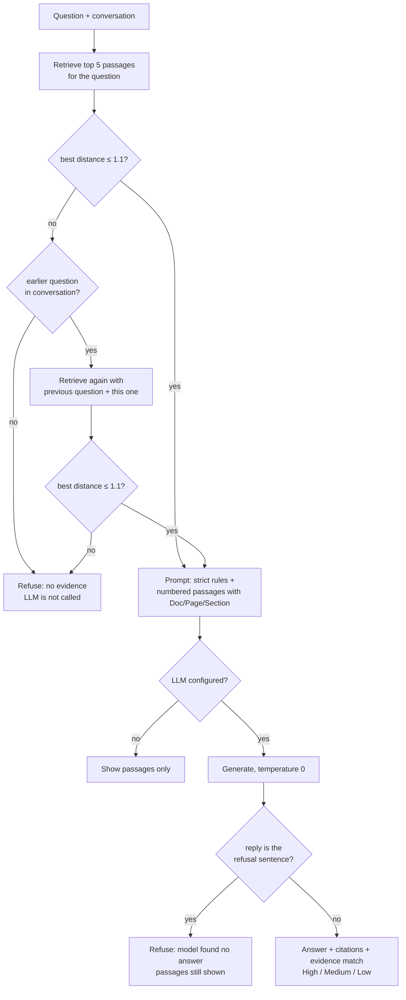
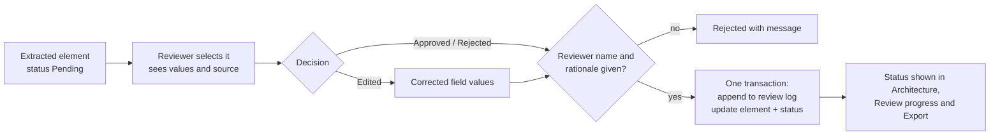

# Architecture

## 1. Problem and intended users

AUTOSAR High-Level Design (HLD) documents describe an ECU's software components (SW-Cs), port
interfaces, ports, signals, dependencies and functional flows. They are long PDFs made mostly of
tables. Answering a question such as *"which SW-C consumes WheelSpeedIf?"* means cross-reading
several tables by hand. Checking that the tables agree with each other (every required interface
has a provider, every dependency is backed by ports) is slow and easy to get wrong. A general chatbot
is no substitute: it answers from training data, cites nothing, and invents plausible component names.

| User | Uses the assistant to |
|---|---|
| System and AUTOSAR architects | Review a design, find inconsistencies, compare revisions, sign off extracted elements |
| Software developers | Look up ports, interfaces and signals quickly, with page references |
| Integration and test engineers | Export the interface and signal inventory for integration and test planning |
| Engineering managers | See review progress and the audit log |

## 2. Solution overview

The assistant ingests HLD PDFs into a local knowledge base, then does five things:

1. **Extracts** a structured architecture inventory (SW-Cs, interfaces, ports, signals, dependencies,
   functional flows), mainly with deterministic table parsers, refined by the LLM when one is configured.
2. **Answers questions** with Retrieval-Augmented Generation. Every answer cites document, page and
   section, and the assistant refuses when the documents hold no evidence.
3. **Checks consistency**: missing providers, unused interfaces, undefined SW-Cs, dependencies not
   backed by ports.
4. **Compares revisions**: what was added, removed or changed between two versions of a document.
5. **Keeps a human in the loop**: an engineer approves, rejects or corrects each element, and every
   decision is logged.



The Streamlit pages and the REST API are thin layers over the same service functions, so the
behaviour is identical whichever one is used.

### Technology choices

| Layer | Choice | Reason |
|---|---|---|
| UI | Streamlit 1.5x (top navigation, light and dark theme) | Case study's recommended pilot UI; fast to build |
| API | FastAPI | Case study's preferred service layer; automatic OpenAPI docs |
| PDF parsing | pypdf | Pure Python; good text extraction from text-based PDFs |
| Embeddings | `all-MiniLM-L6-v2` (sentence-transformers), CPU | Runs locally, so document text never leaves the machine for indexing; 384 dimensions, fast |
| Vector store | FAISS `IndexFlatL2`, persisted to disk | Exact search; at a few hundred chunks per document it is instant and reproducible |
| Structured store | SQLite | Zero setup; holds entities, documents and the review log |
| LLM | Mistral (`ministral-8b-latest`) via its OpenAI-compatible API, or Azure OpenAI | Case study allows any approved LLM; both are reached through the `openai` SDK |
| Orchestration | Custom Python, no framework | The pipeline is short; owning it keeps the grounding rules explicit and testable |

## 3. Workflows

### 3.1 Ingesting a document

```mermaid
sequenceDiagram
    actor U as Engineer
    participant P as pipeline.ingest_pdf
    participant PR as PDFDocumentParser
    participant CH as DocumentChunker
    participant VS as FAISSVectorStore
    participant EX as AUTOSAREntityExtractor
    participant DB as DatabaseManager

    U->>P: upload PDF or pick a sample
    P->>PR: parse()
    PR-->>P: pages with headings; contents pages flagged
    alt document already indexed
        P->>VS: remove_document(name)
        P->>DB: delete_document(name)
    end
    P->>CH: create_chunks(): per page, skip contents pages
    P->>VS: add_chunks(): embed "section + text", save
    P->>EX: extract_all(text, llm if configured)
    EX->>EX: name regexes → table rows (authoritative) → LLM fills gaps, adds only where no table → filters
    P->>DB: add_document() + save_extracted_entities()
    P-->>U: pages, passages, element counts
```

### 3.2 Answering a question



There are two independent safeguards. The **distance gate** stops unsupported questions before any
text is generated. The **refusal check** catches questions whose passages were on topic but didn't
contain the answer.

### 3.3 Review (human in the loop)



### 3.4 Consistency checks and revision comparison

Both run on the extracted tables in SQLite, without the LLM, so they are fast and repeatable.

| Check | Severity | Condition |
|---|---|---|
| Missing provider | Error | An interface is required by some SW-C but provided by none |
| Undefined SW-C | Error | A port owner or dependency end is not in the SW-C definition table |
| Undefined interface | Error | A port refers to an interface missing from the interface table |
| Unused interface | Warning | Provided but never required |
| SW-C without ports | Warning | Defined SW-C with no port in the port table |
| Dependency not backed by ports | Warning | No provided/required port pair on the dependency's interface (either direction, for client-server) |
| Signal on unknown interface | Warning | Signal mapped to an interface that no port uses |
| Missing data type | Info | Signal with no data type |

The comparison matches elements by identity: name; *owner.name* for ports; *source, target,
interface* for dependencies. It reports elements added, elements removed, and attribute changes.

## 4. Design decisions

| Decision | Why | Trade-off |
|---|---|---|
| Deterministic extraction first; LLM fills gaps and may add elements only where the document has no table | Table rows are unambiguous and reproducible; anything the LLM adds is labelled `source = llm` for review | Needs documents that use tables or naming conventions |
| Definition tables are authoritative | Lets the checks detect references to undefined SW-Cs and interfaces | A SW-C mentioned only in prose is not listed |
| Section heading embedded with each chunk | Table-heavy chunks often lack the topic words that their heading carries; measured gain on the evaluation set | Heading detection must be right; it is tested |
| Contents pages not indexed | They repeat every heading and were the top hit for unrelated questions | Detected by heading count (≥ 12 on a page) |
| Distance gate before generation | Unsupported questions never reach the model: safer and cheaper | Threshold must be calibrated on the corpus |
| Fresh LLM client per request, settings per browser session | Settings changes apply at once; one user's key is not shared with another session | Small construction cost per request |
| Review log is append-only and survives a reset | Audit record; a reset removes documents, not decisions, unless explicitly asked | Old entries can point at elements that no longer exist |
| Services free of UI code | The same functions serve Streamlit, FastAPI and the tests | Slightly more modules |

## 5. Case Study 1 coverage

| Case-study capability | Status | Where |
|---|---|---|
| Document upload and controlled ingestion | Done | Documents page, `POST /documents`; PDF only, safe file names, re-ingest replaces |
| Section, table and metadata extraction | Done | `pdf_parser.py`, `autosar_extractor.py` |
| Architecture entity recognition | Done | Six element types; precision and recall 1.00 on the evaluation documents |
| Interface and dependency mapping | Done | Ports by owner and interface; dependency graph on the Architecture page |
| Natural-language question answering with citations | Done | Ask page, `POST /ask` |
| Cited summaries and component reports | Done | Answers with citations; Markdown, JSON and CSV export |
| Revision comparison | Done | Compare page, `GET /compare` |
| Potential mismatch and completeness checks | Done | Architecture → Checks, `GET /checks/{doc}`, included in the report |
| Engineer review, correction and export | Done | Review page with Approve, Reject and Edit; audit log |
| Confidence indicators | Done | Evidence match High / Medium / Low on every answer |
| OCR for scanned pages | Not done | See 126003133_KnownLimitations_v1.0.md |
| Role-based access, project isolation | Not done (pilot scope) | See 126003133_KnownLimitations_v1.0.md |
| Docker deployment | Not done | Runs as a local Python application |
