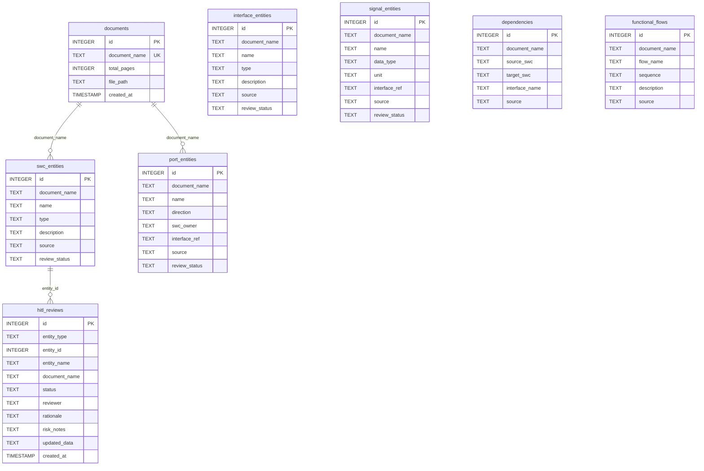

# Data Model

## 1. Input data (knowledge base)

All documents are in `../Input_Data/`. The HLDs are synthetic, so no proprietary OEM or supplier
data is used.

| File | Pages | Description | Used for |
|---|---|---|---|
| `vbcs_brake_system_hld.pdf` | 24 | *Vehicle Brake Control System HLD*, VBCHLD-001 rev 1.0, marked "Synthetic Test Document", obtained from an external website. 6 SW-Cs on three ECUs (SIE, BCU, BAM), 10 port interfaces (7 sender-receiver, 3 client-server), 29 ports, 11 signals, 6 CAN messages on VBC_CAN_A, 19 dependencies, 8 functional flows, diagnostics, error handling, degraded mode | Main evaluation document; ID-numbered tables |
| `ebc_brake_ecu_hld.pdf` | 2 | *Electronic Brake Control ECU HLD*, rev 1.2, generated by `samples/generate_sample_pdf.py`. 4 SW-Cs, 4 interfaces, 6 ports, 6 signals, 3 dependencies, 1 flow | Plain tables without IDs; quick demo |
| `ebc_brake_ecu_hld_v1_3.pdf` | 2 | Rev 1.3 of the same: a new SW-C, a removed consumer port, a required interface with no provider, a dependency on an undefined SW-C, and a changed signal type and unit | Revision comparison and consistency-check demo |
| `AUTOSAR_reference/AUTOSAR_EXP_VFB.pdf` | 107 | AUTOSAR *Virtual Functional Bus* explanatory document | Optional general AUTOSAR knowledge |
| `AUTOSAR_reference/AUTOSAR_CP_SWS_PlatformTypes.pdf` | 30 | AUTOSAR Classic Platform *Platform Types* specification | Optional general AUTOSAR knowledge |
| `AUTOSAR_reference/AUTOSAR_TR_FoundationReleaseOverview.pdf` | 24 | AUTOSAR *Foundation release overview* | Optional general AUTOSAR knowledge |

The AUTOSAR documents are © AUTOSAR GbR, published at autosar.org, and must be cited as such.

## 2. Files written at run time

Everything goes in `Code/autosar_hld_assistant/data/` (or `AUTOSAR_DATA_DIR`), which is created
automatically and safe to delete.

| File | Content |
|---|---|
| `autosar_hld.db` | SQLite database (below) |
| `faiss_index.bin` | FAISS `IndexFlatL2`, 384 dimensions |
| `faiss_metadata.json` | Chunk records; entry *i* describes vector *i* |
| `uploads/*.pdf` | Uploaded files under sanitised names |

## 3. Database schema



- `source`: `table`, `regex` or `llm`, i.e. how the element was found.
- `review_status`: `Pending` (default), `Approved`, `Rejected` or `Edited`.
- `hitl_reviews.updated_data`: JSON `{"field": {"old": …, "new": …}}` for edits, `{}` otherwise.
- Every entity table is indexed on `document_name`. The links between tables are logical (by
  document name and entity id); SQLite foreign keys are not enforced. This is deliberate, so that
  the review log survives when a document is removed.

## 4. Internal structures

**Chunk** (also the FAISS metadata record):
```json
{"chunk_id": "vbcs_brake_system_hld.pdf_p8_c14", "document_name": "vbcs_brake_system_hld.pdf",
 "page_number": 8, "section_header": "3.3 WheelSpeedSensorSWC", "text": "…up to 800 characters…"}
```

**Answer** (`rag/qa_engine.py`):
```json
{"question": "…", "text": "…", "status": "answered", "grounded": true, "confidence": "High",
 "citations": [{"document_name": "…", "page_number": 8, "section_header": "…",
                "chunk_id": "…", "distance": 0.508, "text": "…"}]}
```

**Finding** (`analysis/consistency.py`): `{severity, check, element, message}`.

**Diff** (`analysis/compare.py`): per kind `{added: [...], removed: [...], changed: [{element,
field, old, new}]}`.
